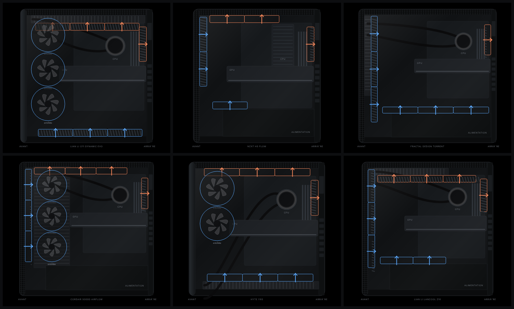
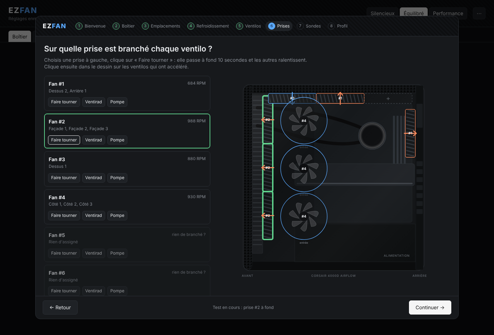

# EZFAN

Contrôleur de ventilateurs pour Windows, pensé pour être simple et visuel : tu vois ton boîtier, ce qui est monté à chaque emplacement, le sens du flux d'air, et tu règles les courbes par rapport aux sondes de température.



## Fonctionnalités

- **Vue du boîtier en direct** : vue latérale du boîtier avec les ventilateurs à leur emplacement, leur vitesse et un flux d'air animé (entrée / sortie).
- **Bibliothèque de boîtiers** : une trentaine de modèles courants (dont le Corsair 4000D) plus un boîtier générique.
- **Assistant de premier lancement** en 8 étapes : choix du boîtier, du refroidissement CPU (ventirad ou AIO), placement des ventilateurs, identification des prises de la carte mère en les faisant tourner une par une, choix des sondes d'entrée et de sortie.
- **4 profils d'utilisation** : Bureautique, Jeux légers, Jeux AAA, Performance.
- **Courbes modifiables** par ventilateur, avec hystérésis et montée progressive, liées à n'importe quelle sonde (CPU, GPU, carte mère…).
- **Sécurités** : ventilateurs à 100 % si le CPU dépasse 95 °C, le GPU 85 °C ou si une sonde ne répond plus. À la fermeture ou en cas de plantage, le contrôle est rendu au BIOS.
- **Icône dans la barre des tâches** et démarrage automatique avec Windows (tâche planifiée).



## Installation

1. Installe le pilote **PawnIO** depuis [pawnio.eu](https://pawnio.eu). Il est nécessaire pour lire les sondes et piloter les ventilateurs.
2. Télécharge `EZFAN.exe` depuis la page [Releases](../../releases) (ou compile-le, voir plus bas).
3. Lance `EZFAN.exe`. Il demande les **droits administrateur**, c'est normal : l'accès au matériel l'exige.
4. L'interface s'ouvre dans ton navigateur sur `http://localhost:5400`. Au premier lancement, l'assistant te guide.

Si tu utilisais déjà Fan Control ou un autre logiciel de ventilation, ferme-le avant : deux logiciels qui pilotent les mêmes ventilateurs se gênent.

Les réglages sont enregistrés dans `%APPDATA%\EZFAN\config.json`.

## Compiler

Il faut le [SDK .NET 8](https://dotnet.microsoft.com/download/dotnet/8.0).

```powershell
cd FanController
dotnet publish -c Release
```

Le fichier `EZFAN.exe` (autonome, un seul fichier, Windows x64) se trouve ensuite dans `FanController/bin/Release/net8.0-windows/win-x64/publish/`.

## Structure

| Dossier | Contenu |
|---|---|
| `FanController/Hardware` | Lecture des sondes et pilotage des ventilateurs via LibreHardwareMonitor |
| `FanController/Control` | Configuration, profils, courbes et boucle de régulation |
| `FanController/Desktop` | Icône de la barre des tâches et démarrage automatique |
| `FanController/wwwroot` | Interface web (vue du boîtier, assistant, courbes) |

## Avertissement

EZFAN agit directement sur le matériel. Il est fourni tel quel, sans garantie : surveille tes températures lors des premiers essais.

## Crédits et licence

EZFAN est distribué sous licence [MIT](LICENSE).

Il s'appuie sur [LibreHardwareMonitor](https://github.com/LibreHardwareMonitor/LibreHardwareMonitor) (bibliothèque `LibreHardwareMonitorLib`), distribuée sous licence [MPL-2.0](https://www.mozilla.org/MPL/2.0/). Merci à ses contributeurs.
